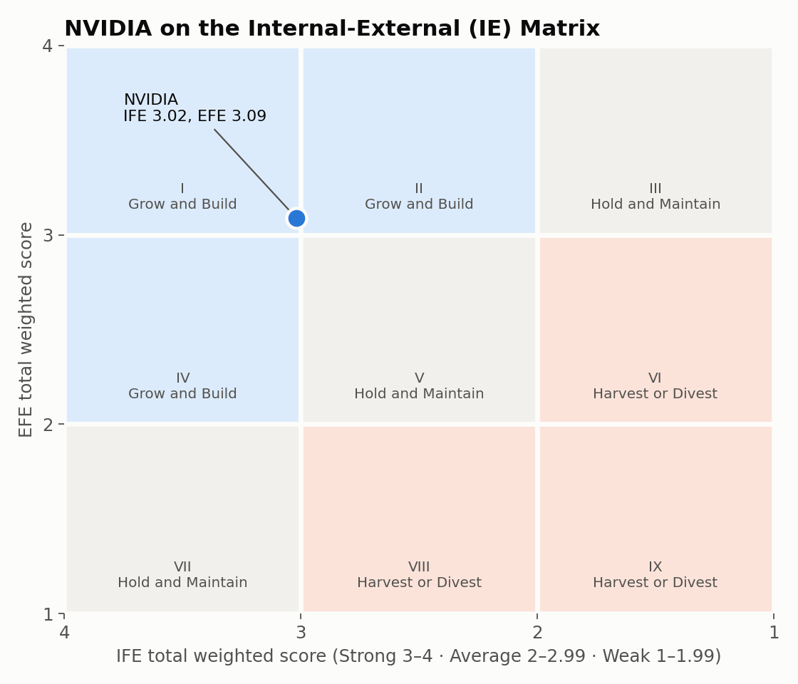

# NVIDIA Strategic Position Analysis (IFE, EFE, and IE Matrix)

This project looks at where NVIDIA stands as a business and what it should do next. I rated NVIDIA's internal strengths and weaknesses and the outside opportunities and threats it faces, then used the scores to place the company on the Internal-External (IE) Matrix. I built it for a class project.

**Tools:** Excel

## How it works

- **IFE Matrix (Internal Factor Evaluation):** 10 strengths and 10 weaknesses. Each one gets a weight for how much it matters (all weights add up to 1.0) and a rating from 1 to 4 for how well NVIDIA handles it. Weight times rating gives a weighted score, and the scores add up to a total between 1 and 4.
- **EFE Matrix (External Factor Evaluation):** the same setup for 10 opportunities and 10 threats.
- **IE Matrix:** the IFE total goes on one axis and the EFE total on the other. Where the two meet tells you the strategy: grow and build, hold and maintain, or harvest or divest.

All the weighted scores and totals are Excel formulas.

## Results

| Matrix | Total weighted score | What it means |
|---|---|---|
| IFE | **3.02** | Strong internal position (3.0 to 4.0) |
| EFE | **3.09** | High response to outside factors (3.0 to 4.0) |

That puts NVIDIA in **Cell I: Grow and Build.**

## What drove the scores

- **Biggest strengths:** AI market leadership (the highest weight on the IFE, 0.08), strong revenue growth, high profit margins, the CUDA software platform, and strong R&D. All were rated 4.
- **Biggest weakness:** export restrictions, the only internal factor rated 1. Supply chain risk, reliance on outside manufacturers, and manufacturing delays also pulled the score down.
- **Biggest opportunity:** growth in the AI market (the highest weight on the EFE, 0.09), followed by cloud expansion.
- **Biggest threats:** rising competition and U.S. trade and export restrictions, each weighted 0.07.

The IFE score of 3.02 is only just above the 3.0 line. Even if it slipped a little below 3.0, NVIDIA would move to Cell II, which is still Grow and Build. So the conclusion holds up even if a few ratings change.

## Recommendation

NVIDIA should keep investing in AI, research and development, and global expansion while it works on its weak spots: supply chain risk, reliance on outside manufacturers, and depending on a small number of very large customers.

## Files

| File | What it is |
|---|---|
| `NVIDIA IFE EFE IE Matrix Analysis.xlsx` | IFE, EFE, and IE Matrix sheets |

*The IE Matrix chart above was made from the workbook's scores so it shows up on GitHub.*
